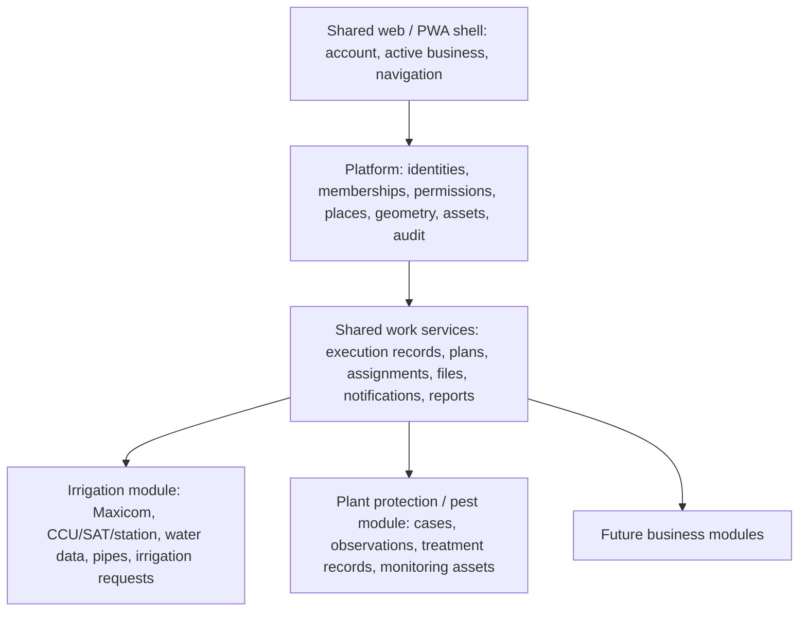

# Multi-team platform expansion: irrigation and plant protection / pest control

**Status:** proposal for review; no implementation or production changes authorized by this document.

**Basis:** current repository and `PM管理_层级结构整理版.md`, reviewed on 8 November 2026. The supplied hierarchy is a business reference, not a set of executable workflow rules.

## 1. Recommended direction

Evolve the existing application into a shared field-operations platform with business modules. Keep one application, account system and deployment initially. Package irrigation as the first business module and add plant protection / pest control as the second.

The foundation should provide accounts, scoped permissions, places and geometry, assets, work records, scheduling, attachments, notifications, reporting and the PWA shell. Each business module owns its professional fields, work categories, forms, operational rules, integrations and report definitions.

Four decisions are central:

1. **A place is independent of an irrigation controller address.** `6-7-28` remains a valid irrigation reference, but a building or monitoring point does not need a three-part code.
2. **Share places deliberately; keep business records separately owned.** Access to a shared polygon does not imply access to another team's work orders, observations, photos or materials.
3. **One account can hold several team memberships and roles.** “Manager” must cease to mean a manager of every business in the application.
4. **Reuse the working system through incremental changes.** Preserve existing irrigation records, URLs, dispatch dates and integrations while introducing the new foundation. Do not fork a second copy of the application.

Assumption: these are teams within the same organization/site. Separate companies with contractual data isolation would require an additional organization/tenant design review.

## 2. What the current code already supports, and what needs separation

| Area | Current implementation observed | Implication |
| --- | --- | --- |
| Geography | `Region`, `Land`, `Patch`, `Zone`; `Patch` also contains Maxicom fields; `Zone` mixes geometry and irrigation attributes | Introduce neutral place identities without forcing buildings into CCU/SAT relationships |
| Boundaries | Manual and DXF geometry, an active source, shared map/editor helpers | Reuse these capabilities; make effective source, ownership and history explicit |
| Accounts | Django user plus `Worker`, `ManagerProfile`, `DepartmentUserProfile`; role helpers largely return a single global role | Keep login identities; introduce business/team membership and scoped permissions |
| Manager checks | `is_admin`, `is_staff` and profile checks grant broad access | Audit every entry point before admitting the second team; hiding navigation is insufficient |
| Work records | `WorkReport`, `WorkReportEntry`, photos, follow-up records, projects and inventory integration | Reuse execution records; add business ownership and neutral targets |
| Work hierarchy | MPTT `WorkItem` tree, but fixed irrigation-oriented `SECTION_CHOICES` and an irrigation-specific parser | Reuse tree handling, but create versioned business catalogues and a new importer |
| Job plans | `JobPlanTemplate.asset_level` supports CCU, SAT and Zone group; `MaintenancePlan` targets their fields | Add target resolvers for places, groups and monitoring assets |
| Rotation | `initialize_rotation()` currently groups plans by frequency value/unit across active plans | Scope rotation pools before adding new-team plans, so the new team cannot move irrigation schedules |
| Crew matching | CCU/SAT and Land coverage; some crew selection assumes CCU-formatted codes | Introduce explicit team/location responsibility assignments |
| Quantities | Work-entry counts and stock transaction quantities use integers | Record fractional treatment quantities with Decimal and units; do not silently reuse integer consumption fields |
| PWA / AI / email | Shared navigation and facilities, with business-specific names and broad role checks | Add business context to navigation, tools, exports, files and scheduled jobs |

Relevant code includes `core/models.py`, `role_utils.py`, `business_rules.py`, `workorder_tree_parser.py`, `workorder_tree_views.py`, `pm_utils.py`, `pm_rotation.py`, `management/commands/generate_pm_workorders.py` and `pwa.py` under `internal_server/`.

## 3. Module boundaries

Use a **modular Django application**, not microservices for this first expansion. Suggested logical packages are `platform/identity`, `platform/places`, `work_management`, `business/irrigation`, `business/pest_control` and `integrations`.

These names describe ownership boundaries. Moving every existing model into a different Django app is not the first step: model app labels, migrations, content types, permissions and existing tables need controlled treatment. Initially retain `core` models and routes, put new services behind clear interfaces, and use compatibility adapters. Physical extraction can follow once the pilot is stable.

A module registry should declare its menus, permitted location/asset types, catalogues, forms, plan target resolvers, reports and AI tools. Use reviewed application code plus validated configuration; do not introduce arbitrary uploaded Python/JavaScript or an unrestricted workflow scripting engine.

## 4. Shared places, flexible codes and partial sharing

### 4.1 Separate identity, geography and business meaning

Proposed concepts:

| Concept | Purpose |
| --- | --- |
| `Location` | Stable identity, name, location type, optional parent and optional geometry |
| `LocationIdentifier` | Aliases or external references, scoped by namespace/business; codes are not hierarchy instructions |
| `LocationGroup` / membership | Team service areas, routes or operational groupings independent of physical containment |
| `BusinessLocation` | Makes a location available to a business; stores that business's label, priority and responsibility settings |
| `LocationGeometryRevision` | Geometry, source/file, author, time and selected effective version; one authoritative place to resolve displayed geometry |
| `Asset` | A physical managed item at a location: a monitoring station, trap, hive box, controller or other equipment |
| Business-specific profile | Irrigation settings or pest-specific settings attached to the relevant location/asset, rather than universal columns |

Internal IDs establish identity. Human codes are optional business identifiers; where present, uniqueness is scoped explicitly. Do not infer parent, site, permissions or ownership by splitting a code on hyphens.

Examples:

| Example | How it fits |
| --- | --- |
| Existing `6-7-28` | Existing irrigation zone linked to a neutral location; preserve its current code and source mappings |
| `BLDG-A` / “Administration Building” | Building location, owned by its designated steward and enabled for the pest business |
| “Building A → Floor 2 → Pantry” | Optional physical containment; no need for a polygon for each level |
| “North monitoring route” | A group of places/assets, not an invented physical parent |
| `TRAP-017` | A monitoring asset within a place; repeated observations attach to the same asset |

The interface must support flat search and selection as well as a hierarchy. A building footprint does not locate a particular floor or room; record floor/room information explicitly. Point and polygon/multipolygon geometry, and locations with no geometry, cover the initial pilot. Keep the model open to other geometry types when a real use case needs them.

### 4.2 Partial sharing rules

- A location steward enables a selected set of existing places for the new business. Existing irrigation places are not all shared by default.
- For the **same physical place**, reference its identity and approved geometry; do not copy polygons into new team-owned zone rows.
- If pest service coverage differs from irrigation coverage, create a separately identified service area and record an explicit coverage/overlap relationship. Geometric overlap alone does not make two places identical or grant access.
- A business may have its own display name, crew, priority and operational grouping on a shared place. These do not change another business's settings.
- Changes to canonical shared geometry require the steward's permission and create a revision. A pest operator cannot silently reshape an irrigation zone.
- If a team needs a different operational outline, use an explicit service-area geometry, with its own owner and source. The map must make clear which outline is being displayed.
- Work records retain the location ID plus a name/code and geometry-revision reference at execution/issue time. Editing today's boundary must not rewrite historical evidence.

The current manual/DXF selection can be adapted into this model. During transition, use a single resolver over the existing fields; do not independently update competing geometry stores. The recently discovered editor/homepage mismatch is an acceptance-test case for the new foundation.

### 4.3 Isolate irrigation addressing

Keep CCU/SAT/station numbers and Maxicom source identifiers in irrigation-specific mappings/profiles. Preserve existing relationships and any multiple-station mappings. Buildings and pest monitoring assets must never become fake CCUs or require Maxicom records to be saved.

## 5. Account system and permissions: required before the pilot

### 5.1 One identity, multiple memberships

Distinguish these concepts:

- **Business area:** irrigation, plant protection / pest control, and later other services.
- **Team:** an operational group within a business area; there can be several crews/teams per business.
- **Membership:** user + team + role + optional location/responsibility scope, with active dates/status.
- **Account identity:** the existing Django user/employee identity. Joining another team does not require a duplicate login.

Keep employee/person attribution separate from authorization. Existing `Worker` records can continue to identify the person performing work. A `ManagerProfile` is not sufficient authority to manage a newly added business.

Examples:

| Account assignment | Allowed by default |
| --- | --- |
| 灌溉一线 | Assigned/authorized irrigation tasks and enabled places; submit irrigation records |
| 植保一线 | Assigned/authorized pest tasks/cases and enabled places; submit observations and execution records |
| 植保经理 | Manage assigned pest teams, review their work and manage their permitted plans; no implicit irrigation administration |
| 灌溉经理 | Corresponding irrigation management scope |
| One person in both businesses | Separate memberships; explicitly switch the active business/team context |
| Location steward | Maintain/share designated common places and geometry; does not automatically gain access to all work at those places |
| Platform administrator | Provision businesses, assign elevated roles and administer the platform; sensitive cross-business access is explicit and audited |

Separate a team manager from a business administrator if one person needs to manage every team within a business. A field user should not gain broad record visibility merely because a shared place appears on their map.

### 5.2 Enforcement model

Permission is evaluated as:

**active account + active membership + allowed action + record ownership + location/assignment scope**.

The server derives ownership from the stored object and validates the requested active context. A browser-supplied business ID is a selector, not authorization. Central scope services must be used by web views, REST endpoints, detail pages, searches, autocomplete lists, bulk actions, exports, background jobs and AI tools.

Shared location access grants only the approved place metadata/geometry. Work orders, pest observations, attachments, counts, remarks, approval queues and exports remain scoped to their owning business/team unless expressly shared.

Audit and replace broad `is_admin()`/`is_staff` checks in business operations. Reserve Django staff/admin-site access for explicit technical administration rather than using it as the new business-role model. Identify existing true platform administrators during migration; do not promote every existing irrigation manager into a platform administrator.

Registration should support requests to join a team. A manager may approve permitted field memberships within their own scope; elevated role grants follow a separate administrative permission. Disable a membership to remove access to one team, and disable the account to remove access everywhere. Reassignment of open tasks must accompany departure from a team.

Legacy tokens/profile authentication require a compatibility path into the same membership checks. Background senders and schedulers need explicit business context. Permission caches must invalidate on membership changes; a suspended membership cannot remain usable through an old token/session.

### 5.3 Account and workspace UI

Add an active business/team selector to the web and PWA shell. After selecting 植保, show pest cases, monitoring tasks and that team's map layers; after selecting 灌溉, show irrigation operations and Maxicom data.

The profile page lists memberships and roles. User administration gains team membership, scoped role assignment and responsibility-area controls. Registration and approval messages must name the team and requested role.

Keep an unsaved form in its original business context when the user switches teams: warn/preserve the draft instead of silently changing ownership. Any later offline-write queue must retain that immutable context and recheck authorization on synchronization. The current PWA shell should not be presented as a complete offline data-entry system.

## 6. Interpret the supplied pest hierarchy correctly

The document describes seven top-level categories and thirty management objects, with deeper levels and seven attached list items. It includes objects, behaviors, locations, conditions, measures, outcomes and follow-up actions at overlapping depths.

Examples include:

- `传粉昆虫 → 蜜蜂 → 自然筑巢 → 建筑 → 人工处理 → 报封堵工单`;
- `蛀食类害虫 → 白蚁监测 → 有活动 / 无活动`;
- bird observations followed by waiting, reassessment, removal, transfer or release outcomes.

Do not flatten these into six mandatory dropdowns or treat every descendant as a task that must be completed. Likewise, “无需处理” is a meaningful recorded outcome, not an empty submission.

### 6.1 Two layers: catalogue and executable procedure

1. **Reference catalogue:** preserve the submitted wording, parent-child relationships, order, source paths and attached-note distinctions. Give nodes stable IDs; repeated labels such as 人工处理 are distinct nodes by path, not globally unique names. Allow variable depth. Import into a draft version, with a reconciliation report for missing, duplicated or reparented nodes.
2. **Approved job/procedure templates:** the pest business owner decides which nodes represent observations, single-choice conditions, multiple actions, outcome fields, explanatory text or follow-up tasks. Required fields, branch conditions and completion criteria are configured explicitly.

Use the current tree renderer/data patterns where practical, but do not reuse the irrigation parser unchanged: it expects `--|__` source lines and a fixed section dictionary. A dedicated importer should parse this document's headings and nested bullets, preserving the seven attached steps without pretending that indentation alone defines workflow semantics.

Publish immutable template versions. Issued tasks and submitted records keep the version and selected-path/label snapshots, so later catalogue edits do not relabel historical work. Draft changes need a preview and business-owner publication step.

The attachment primarily covers pest, insect and animal-management scenarios. Additional plant-health/disease catalogues can be added to this business later; do not invent their contents during this import.

### 6.2 Pilot form experience

On a phone:

1. Choose a place, asset or a provisional incident point; search by name or any allowed code.
2. Choose the management object and relevant scenario, with search and recent/favorite paths.
3. Show only applicable observations, actions and result fields; show the chosen breadcrumb for review.
4. Record evidence, personnel, materials and follow-up needs; submit or save a draft.

Suggested structured data includes observation time, object/species label from the approved catalogue, count and unit, observed activity, photos, action taken, result, assignee and next review date. A monitoring asset needs a stable ID and repeated dated observations, including an explicit “none observed” result; absence of a record is not zero activity.

Treatment records, if included in the pilot, need product/material, quantity and unit, application area/method and operator details from the team's approved operating requirements. This is a data-model requirement, not a recommendation of products or treatment parameters.

## 7. Work records, cases, schedules and cross-team handoffs

### 7.1 Reuse the existing execution record

Treat “shared work order” as a logical capability first. Extend the current `WorkReport`/entry path with business ownership, owning team, neutral location/asset targets and a versioned form reference. Existing irrigation work entries and IDs remain valid.

Do not create a second independently editable generic work-report table and synchronize it with `WorkReport`. During transition, legacy zone/patch relationships are served by an irrigation adapter; new-business writes use neutral targets. Define one authoritative write path and reconciliation checks for compatibility links.

Retain the existing distinction between a scheduled task (`GeneratedWorkOrder`) and its completion record. Generalize its target resolution rather than creating a separate pest scheduling engine.

### 7.2 Add a pest case above related visits

One pest incident may require several visits. Introduce a `PestCase` with its location(s), responsible team, management object, current status and follow-up date. Each visit/inspection/treatment is an execution record linked to that case.

Separate **visit completed** from **case resolved**. For example, an inspection can be completed while the case remains “monitoring” or “waiting for another team”. Candidate case states are new, assigned, in progress, monitoring, awaiting external action, pending review, resolved and cancelled; the business owner confirms transitions and closure evidence.

An observation should not automatically create a chemical-treatment task merely because a treatment node exists below it in the supplied hierarchy.

### 7.3 Generalize scheduled work carefully

Keep current calendar-month behavior, saved completion windows, rotation phases and dispatch idempotency. Add:

- business/team ownership of plans and job templates;
- target resolvers for explicit locations, approved groups and monitoring assets;
- explicit responsibility assignments independent of CCU-format codes;
- named rotation pools scoped by business and workload/responsibility grouping, rather than frequency alone;
- dispatch snapshots of target membership, form version, assignee and deadline;
- deliberate handling of future schedule changes without altering already issued work.

Adding pest plans must not change irrigation due dates or rotation slots. The pest owner must also choose whether each routine needs a strict observation interval or an evenly spread workload: those are different scheduling policies. Preserve current irrigation policy unless expressly changed.

### 7.4 Cross-team work

“报封堵工单” and “保洁清理” are explicit handoffs. Create a linked service request addressed to a team with location, due date, evidence and acknowledgement/completion states. The recipient sees the approved handoff information, not unrestricted access to the source case.

Each work record has one owning business/team. Collaboration uses participants and typed links such as follow-up, blocks, requested-by and resolves; it does not make every linked record jointly owned. Keep an external-reference option if the receiving team is not yet on the platform. Do not automatically close the source case when a request is merely sent.

## 8. What stays inside irrigation, and what is shared

| Shared platform/service | Irrigation module | Pest business module |
| --- | --- | --- |
| Login, memberships, permissions | CCU/SAT/station addressing and external-key reconciliation | Pest catalogue and scenario templates |
| Places, geometry revisions, common assets | Maxicom synchronization, runtime and flow sensors | Cases, monitoring points/traps and observations |
| Work execution, attachments, assignment, follow-up infrastructure | Pipes, valves, irrigation intensity and water requests | Intervention/treatment details and revisit rules |
| Calendar scheduling, notifications and export delivery | Irrigation job-plan target adapters and specialist reports | Pest-specific job plans, case outcomes and specialist reports |
| Design system and PWA shell | Irrigation map overlays and water heatmaps | Object/activity layers, monitoring history and case maps |

Inventory catalogues can be shared deliberately, but warehouse access, custody and consumption ownership must be explicit. A shared material catalogue is not automatically shared stock. For fractional quantities, design Decimal base units/conversion and migration rules before posting treatment use into the current integer-only stock ledger; a structured usage record can precede full stock integration.

Reporting must filter by ownership before aggregating. Shared zones must not inflate both teams' counts. Define separate measures for cases, visits, inspections, interventions and recurring-task completion. Scheduled email configurations and recipients are business-scoped, including background execution.

EnGenie should receive the active business context and use permission-scoped server tools/read models. Enforce permissions before SQL/search/export/file access; prompt instructions alone cannot isolate data. Retain auditability of authorized cross-business summaries. Scoped downloads/attachments also need access checks rather than relying on an unguessable or publicly served file path.

## 9. Delivery sequence and release gates

| Phase | Deliverable | Gate before proceeding |
| --- | --- | --- |
| 0 — Agree the pilot | Reviewed catalogue mapping; selected shared zones/buildings; named teams, managers, place steward and approved pilot scenarios | Business owners confirm branch meanings, responsibility and closure criteria |
| 1 — Ownership and accounts | Business/team membership, central permission scopes, irrigation ownership backfill, scoped menus/exports/AI/jobs | No cross-team record leakage; existing irrigation behavior preserved |
| 2 — Neutral places and irrigation adapter | Stable location IDs, legacy links, explicit place sharing, generic target selection, effective geometry/source resolution | Shared and private locations behave correctly; no forced `xx-xx-xx` identifiers |
| 3 — Pest pilot workflows | Draft/import/publish catalogue; cases and visit forms; monitoring assets; scoped job plans and handoffs | Representative end-to-end scenarios pass on phones and desktop |
| 4 — Controlled live pilot | Limited crew and location set; scoped reports/email; support and operational metrics | Owners confirm correctness, usability and irrigation non-regression |
| 5 — Package and broaden | Extract stable module services; template the onboarding process; migrate further specialist functions as needed | A third business can be added through module/configuration boundaries without another copy of the app |

Phases 1 and 2 are prerequisites for new-team access. Do not temporarily put pest staff into the old global manager role to accelerate the pilot.

Relative effort is medium for the account/place foundation and large for the complete scenario, follow-up and reporting pilot. A reliable calendar estimate should follow Phase 0 mapping and an endpoint inventory; this plan does not assume the document's entire tree is a ready-to-run form specification.

### Initial pilot scope

Include selected existing shared zones, at least one new building/room, point-based monitoring assets, team-scoped accounts, recurring inspections, incident cases, follow-up records, a handoff and basic exports. Validate representative paths such as termite monitoring and a building-related bee incident, then expand catalogue coverage as meanings are approved.

Keep existing irrigation scheduling, Maxicom ingestion, water calculations and production records intact. Full offline editing, predictive pest recommendations, a generic workflow designer and complete chemical-stock automation are later projects unless made explicit pilot requirements.

## 10. Data migration and rollout safeguards

1. Take a verified backup and record counts/IDs, effective geometry hashes, pending tasks and scheduled dates. Rehearse against a restored copy.
2. Add new ownership/membership/place structures. Existing business data is explicitly backfilled to irrigation; legacy null ownership is not a wildcard for all teams.
3. Link existing zones to locations idempotently. Do not regenerate existing zone/work/PM IDs, human codes, Maxicom keys or historical references.
4. Map existing managers and workers to reviewed irrigation memberships. Designate platform administrators separately. Do not reinterpret all departmental requesters as field workers.
5. Introduce compatibility reads and **one transactional write path**, with mismatch detection. Avoid prolonged bidirectional dual writes.
6. Scope dispatch, rotation pools, notifications and exports before enabling pest plans. Test dry runs twice for idempotency and compare all existing irrigation issue dates/deadlines.
7. Enable the new business only for pilot members through a feature flag. Record every permission and geometry-sharing change.
8. Expand after the release gates pass; retire compatibility paths only after reconciliation and a separate migration review.

If rollback is needed, disable new-business entry points, dispatchers and scheduled sends while retaining captured records. Revert application behavior through the compatibility path. Do not restore an old database over valid work captured after launch; any restore requires a reconciled recovery procedure.

The current configuration uses SQLite. Retain it for an isolated development/prototype stage, but establish a concurrency/locking baseline and decide the production database before broadening simultaneous team writes. If PostgreSQL is chosen, rehearse it as a separate infrastructure migration, and test scheduling/stock transactions on that engine. Spatial indexing can be added when query needs justify it; it is not a prerequisite for flexible location identifiers.

## 11. Acceptance scenarios

- Existing irrigation users, runtime/flow data, work histories, dispatch dates and completion windows remain correct.
- One user can be 灌溉一线 and 植保经理, with the correct permissions after switching context.
- A 植保经理 cannot approve an irrigation order by changing a URL, request ID or export filter.
- A field user cannot create work under another business by modifying the submitted business/team ID.
- A suspended membership loses access to its pages, APIs, attachments, queued operations and AI results.
- Pest users see only explicitly shared irrigation locations plus their authorized new places; a building without a CCU/SAT code is usable.
- Sharing a place does not expose the other business's work details, photos, counts, priority or remarks.
- The map, detail page, editor and export agree on the effective geometry and source. An unauthorized geometry edit fails.
- An approved catalogue update does not alter historical paths or already issued task forms.
- A “no activity” monitoring record differs from a missing visit; “no intervention required” can close the appropriate visit with evidence.
- Completing a visit does not close a case that requires monitoring or a building/cleaning handoff.
- New pest plans cannot change irrigation rotation slots or issue duplicate work when a dispatcher retries.
- Cross-team handoffs expose only authorized request content and record acknowledgement and final outcome.
- Treatment quantities and units are preserved without integer rounding or mixed-unit totals.
- A long scenario breadcrumb and long building/file names remain usable on a phone; business switching cannot relabel an unsaved form.
- Representative map, work-list and submit timings are compared with the pre-change baseline using realistic pilot and growth datasets.

## 12. Decisions to confirm in Phase 0

| Decision | Proposed starting position |
| --- | --- |
| Who may share or alter a common boundary? | A designated place steward; field users request a change |
| Which zones are shared? | An explicit approved list, not all irrigation zones |
| Does plant protection use the same area outlines? | Reuse identical places; create related service areas only where scope differs |
| Who manages accounts? | Central account identity; managers administer permitted memberships in their own teams |
| Who can see cross-team records? | Explicit per-role/request sharing; shared location alone grants none |
| Is the hierarchy a catalogue, a checklist or a decision tree? | A reference catalogue first, then reviewed procedure templates per scenario |
| Which other teams receive handoffs? | Start with named contacts/teams and external references where needed |
| What must be captured for treatment and monitored assets? | The pest owner's approved fields, units and evidence requirements |
| Do routines need fixed observation intervals or workload spreading? | Explicit per-job policy; keep irrigation's existing policy |
| What is the first release? | Account/location foundation plus a limited pest pilot; broaden after operational review |

Once these are agreed, the next artifact should be a concrete implementation backlog with schema changes, affected endpoints, migration scripts and named acceptance tests. No business records, accounts, schedules or production settings should be changed as part of approving this architectural plan alone.
